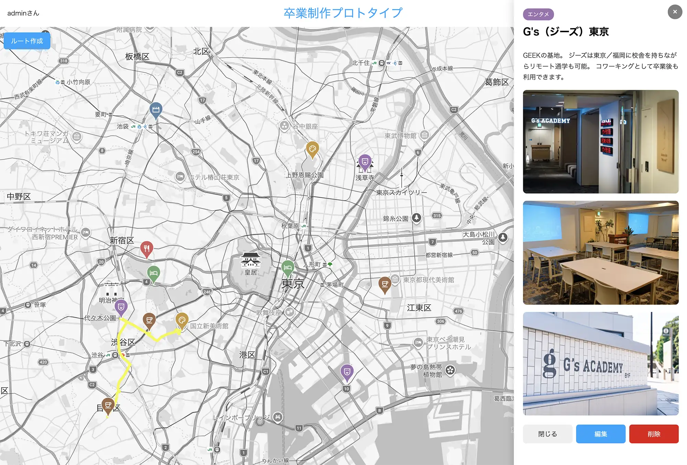

# ①課題名

おでかけマップ（卒業制作プロトタイプ）

# ②課題内容（どんな作品か）

- 地図上の好きな場所にピンを立てて、スポット（カフェ・レストランなど）を記録・共有できるWebアプリ
- 以前、JavaScript×firebaseで作成したものを React×PHPで再構築しました。既存のプロジェクトにはなかったルート計算（Google Map Direction API）も組み込みました。

## ③アプリのデプロイURL

https://gs2026-arakawa.sakura.ne.jp/kadai10_proto/

## ④アプリのログイン用IDまたはPassword（ある場合）

一般ユーザーアカウント

- ユーザー名：test1
- パスワード：test1

管理者ユーザーアカウント

- ユーザー名：admin
- パスワード：mypassword04

## ⑤工夫した点・こだわった点

- セッションベース認証に加え、「自分のピンかどうか」の所有者チェックを実施して他ユーザーの投稿を編集・削除できないようにしました。
- 開発環境と本番環境でAPIのURLが変わる問題を、Viteの環境変数（`.env.local`/`.env.production`）とビルド時の`base`設定で行い、コードを変更せずに切り替えられるようにしました。

## ⑥難しかった点・次回トライしたいこと（又は機能）

- まだ実装できていない機能として、カテゴリやピンのフィルター、お気に入り機能・検索・マイページなど沢山あります。今後、卒業制作に向けて、順次、進めていきたいです。

## ⑦フリー項目（感想、シェアしたいこと等なんでも）

- 自分の手でReactのプロジェクトを1から作り上げることの大変さに加え、PHPからデータを連携する際にも何度も行き詰まり、AIに頼りつつ、なんとかデプロイまで進めました。
